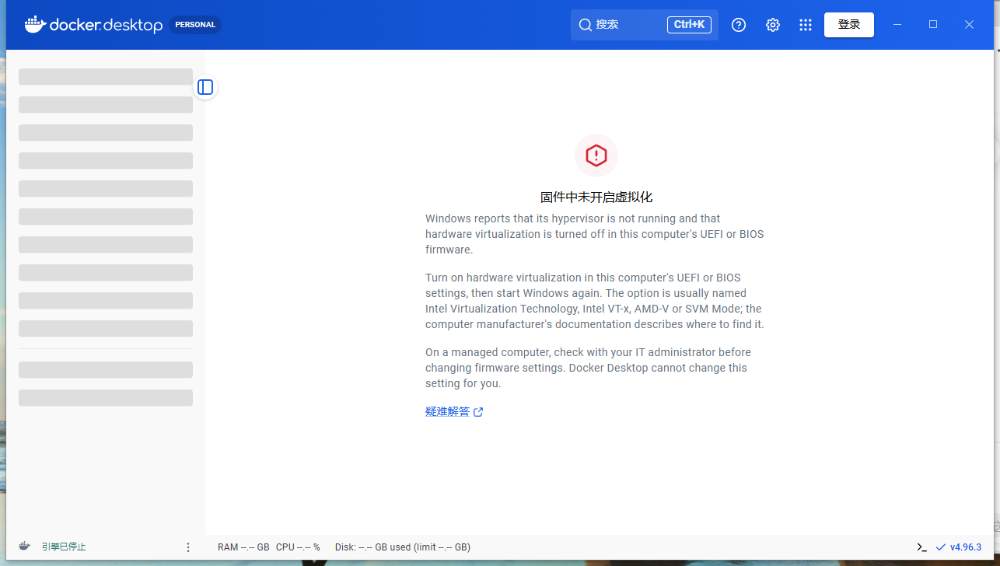

# Docker Desktop 汉化脚本 (dd-zh)

[](LICENSE)
[]()
[]()

给 **Docker Desktop for Windows** 的界面打中文汉化补丁的本地脚本。
一键安装、一键还原，不修改任何程序逻辑，可随时恢复英文原版。



- ✅ 实测版本：**Docker Desktop 4.96.3**（Windows 10/11）
- ✅ 全流程实测：安装 / 更新词典 / 卸载还原 / 重装
- ✅ 补丁前后全量字节级校验，失败自动回滚
- ⚠️ Docker Desktop 升级后需重新运行 `install`（对版本变化不敏感，通常直接可用）

## 工作原理

- Docker Desktop 的界面是一个 Electron 应用，UI 资源打包在
  `frontend\resources\app.asar` 中。
- 本脚本重写 app.asar 头部：向两个 UI 目录（`desktop-ui-2-build`、
  `desktop-ui-build`）各新增一个同源脚本 `dd-zh.js`（约 40 KB，含约 790 条
  词典），并在 `index.html` 头部注入 `<script src="/dd-zh.js">`。
  其余 1300+ 个文件字节原样保留、偏移量不变，并按 asar 规范重算被修改
  文件的 SHA256 完整性字段。页面 CSP 为 `script-src 'self'`，因此必须用
  外部脚本文件而非内联脚本。
- `dd-zh.js` 在 React 渲染前启动，用 `MutationObserver` 把界面上的英文文案
  实时替换为词典中的中文。它**不修改任何 JS 字符串常量**，因此不会破坏
  程序逻辑（状态判断、Redux、IPC 均不受影响）。
- **反篡改对抗**：Docker 对 Electron 前端做了加固——
  `frontend\Docker Desktop.exe` 内嵌了 sha256(app.asar 头部 JSON) 的 hex
  字符串，启动时原生校验（不匹配则进程直接退出）。本脚本会用等长替换
  同步改写 exe 内嵌的这 64 个字符，并先备份原 exe。
  这会使该 exe 的数字签名失效，但经实测 Docker Desktop 运行不受影响；
 介意的话用 `uninstall` 可 100% 还原。

## 使用

依赖：**Node.js**（任意较新版本，仅用于执行打包/校验脚本）。
以管理员身份运行 PowerShell：

```powershell
cd docker-desktop-zh

# 安装 / 更新汉化（会自动关闭并重启 Docker Desktop）
powershell -ExecutionPolicy Bypass -File dd-zh.ps1 install

# 查看状态
powershell -ExecutionPolicy Bypass -File dd-zh.ps1 status

# 还原英文原版
powershell -ExecutionPolicy Bypass -File dd-zh.ps1 uninstall

# 指定自定义安装路径
powershell -ExecutionPolicy Bypass -File dd-zh.ps1 install -DockerPath "D:\Docker\Docker"

# 安装但不自动启动 Docker Desktop
powershell -NoProfile -ExecutionPolicy Bypass -File dd-zh.ps1 install -NoStart
```

首次安装时自动备份：

- `frontend\resources\app.asar.bak` —— 原始 asar
- `frontend\Docker Desktop.exe.dd-zh.bak` —— 原始前端 exe

**卸载/还原/更新都依赖这两个备份，请不要删除。**

## 扩充词典

编辑 `src\zh-cn.dict.json` 的 `exact` 字段（键 = 界面上的英文原文，值 = 中文），
然后重新运行 `install`。词典为「整句精确匹配」（另有大小写不敏感兜底与
相对时间等内置模式），因此：

- 键必须和界面上显示的英文**完全一致**（含大小写与标点）；
- 界面上带换行的长段落可能被 React 拆成多个文本节点，长句词条不一定命中；
- 带参数的动态文案可扩展 `src\translator.js` 中的正则模式。

## 文件结构

```
docker-desktop-zh/
├── dd-zh.ps1            # 主脚本：install / uninstall / status
├── tools/
│   └── repack.js        # asar 补丁引擎（build / verify / status / exe），无第三方依赖
└── src/
    ├── translator.js    # 注入到页面的翻译运行时模板
    └── zh-cn.dict.json  # 中英词典（可自行扩充）
```

## 安全与回滚

- `repack.js build` 输出的补丁包会经过 `verify` **全量字节级校验**：
  未修改文件逐一比对原文件，新增/修改文件与预期内容比对并重算完整性，
  全部通过才会替换 `app.asar`。
- 替换采用「改名旧文件 → 移入新文件」两步，失败自动回滚。
- `uninstall` 将 asar 与 exe 内嵌哈希一并还原，回到 100% 英文原版。
- Docker Desktop 升级会同时替换 asar 与 exe，此时汉化自动失效；
  重新运行 `install` 即可（脚本检测到版本变化会自动重建两份备份）。

## 排错

- 界面没变化：先运行 `status` 确认「已汉化」；再看渲染进程控制台日志
  `%LOCALAPPDATA%\Docker\log\host\electron-ui-console-*.log`，正常应有
  `[dd-zh] translator script executing, dict entries: ...`；若看到
  `Integrity check failed ... '<header>'` 说明 exe 内嵌哈希与 asar 不匹配
  （比如 Docker Desktop 升级过），重跑 `install` 即可。
- Docker Desktop 完全起不来且 `uninstall` 也失败：手动把
  `app.asar.bak` 复制回 `app.asar`、`Docker Desktop.exe.dd-zh.bak`
  复制回 `Docker Desktop.exe`。

## 已知限制

- 主进程创建的原生菜单/托盘右键菜单不经过渲染进程，不在汉化范围内。
- 容器日志、终端（xterm）、Inspect 的 JSON 内容为数据原文，有意不翻译。
- 界面上带换行的长段落（如个别错误说明）可能因文本节点拆分而保留英文，
  可按需往词典里补短句。
- 极少数与业务键名同形的短词（如 `Created`）按最常见的界面语境翻译。

## 免责声明

- 本项目与 Docker, Inc. 无任何关联，Docker Desktop 是 Docker, Inc. 的产品。
- 本脚本仅在你本机的安装上做补丁，不分发 Docker Desktop 的任何文件。
- 修改本机安装文件可能导致程序异常或违反 Docker 的服务条款，请自行评估风险，
  使用本脚本产生的一切后果由使用者自行承担。
- 如果认同 Docker Desktop 的价值，请考虑购买 Docker 的付费订阅支持官方。
